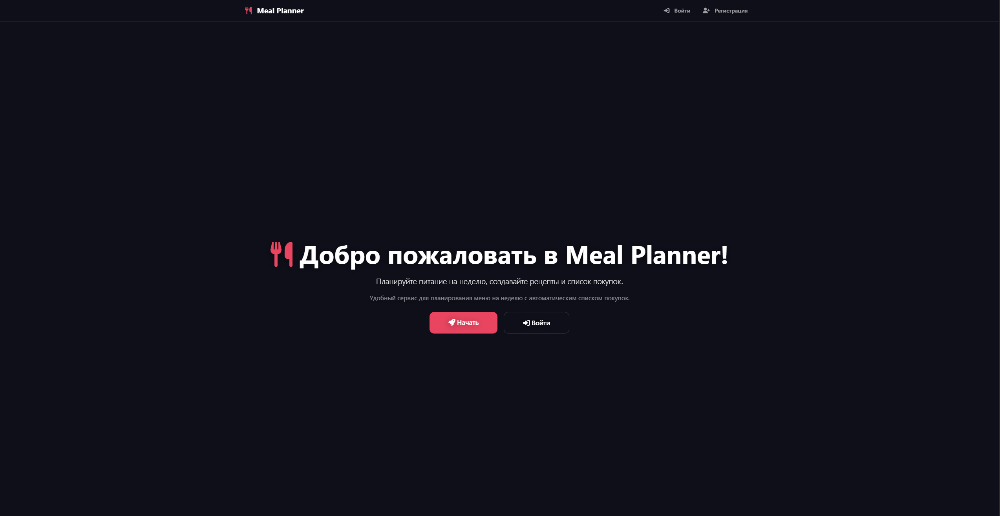
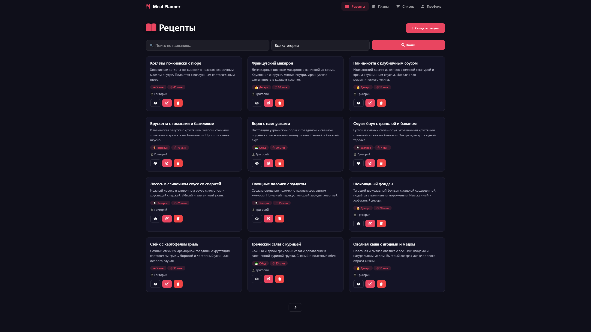
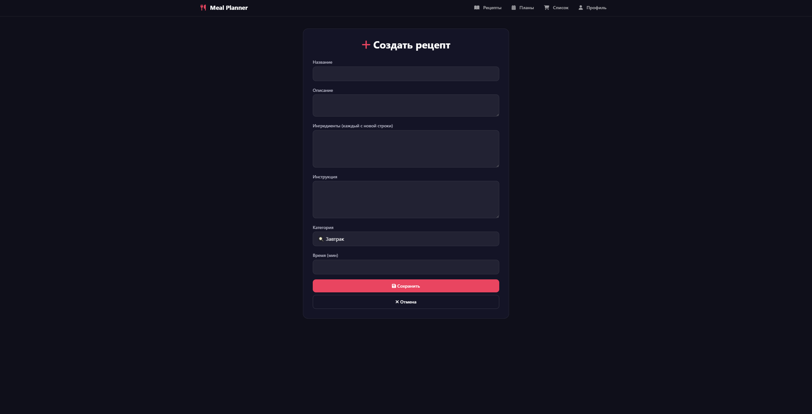
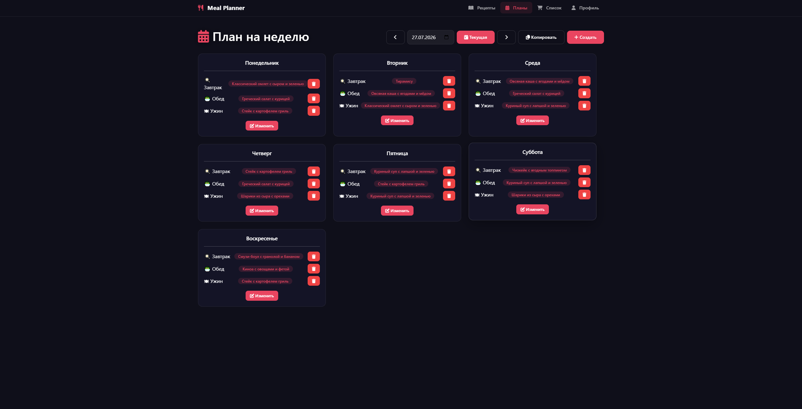
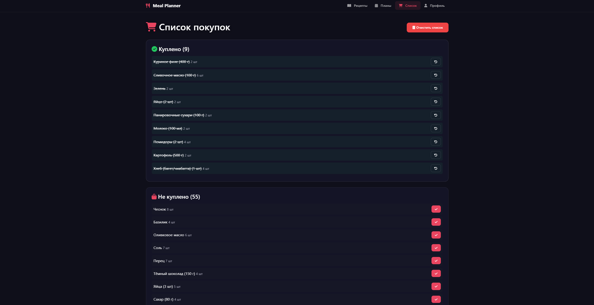

# 🍽️ Meal Planner

[](https://github.com/Backend-Gregory/meal_planner/actions/workflows/ci.yml)

**Веб-приложение для планирования питания на неделю с автоматическим списком покупок.**

Это полноценный сервис, где пользователи могут создавать рецепты, планировать меню на неделю и автоматически формировать список покупок. Проект разработан на FastAPI с использованием Docker и Nginx.

---

## 📸 Скриншоты

### Главная страница


### Рецепты


### Создание рецепта


### План на неделю


### Список покупок


---

## 🚀 Функционал

### 👤 Пользователи
- Регистрация и вход (JWT Access + Refresh)
- Обновление профиля (имя, email, пароль)
- Администратор может блокировать/разблокировать пользователей

### 📚 Рецепты
- Создание, просмотр, редактирование и удаление
- Фильтрация по категории
- Поиск по названию
- Пагинация
- Поле `is_public` для публичных/приватных рецептов

### 📅 Планирование
- Создание плана на неделю (завтрак, обед, ужин)
- Выбор рецептов на каждый день
- Копирование плана на следующую неделю
- Редактирование и удаление

### 🛒 Список покупок
- Автоматическая генерация из плана
- Отметка продуктов как купленных
- Очистка списка

### 🛡️ Админ-панель
- Управление пользователями (блокировка/разблокировка)
- Удаление любых рецептов

---

## 🛠️ Технологии

### Бэкенд
- Python 3.12
- FastAPI
- SQLAlchemy 2.0 (async)
- PostgreSQL 15
- JWT (Access + Refresh Tokens)
- Alembic (миграции)
- Pytest (~100 тестов, 97% coverage)

### Фронтенд
- HTML5, CSS3, JavaScript
- Bootstrap 5
- Animate.css
- Glassmorphism

### Инфраструктура
- Docker + Docker Compose
- Nginx (reverse proxy)
- GitHub Actions (CI)

---

## 🧪 Тестирование

Проект имеет **высокое покрытие тестами**:

- **~100 тестов** (unit, integration, E2E).
- **Покрытие: 97%**.
- **CI:** GitHub Actions запускает тесты при каждом push.

### Запуск тестов

```bash
# Внутри контейнера
sudo docker-compose exec backend python -m pytest tests/ -v

# С покрытием
sudo docker-compose exec backend python -m pytest tests/ --cov=app --cov-report=term-missing
```

## 🚀 Запуск проекта
```bash
# Клонирование
git clone https://github.com/Backend-Gregory/meal_planner.git
cd meal_planner

# Настройка окружения
cp backend/.env.example backend/.env
# Обязательно измените SECRET_KEY в env на свой собственный(сгенерировать можно командой openssl rand -hex 32)
# Если вы запускаете проект локально (без Docker), измените DB_HOST с db на localhost.

# Запуск через Docker Compose
docker-compose up -d --build

# Остановка
docker-compose down

```
**Сервисы:**
| Сервис | Порт (хост) | Доступ |
|--------|-------------|--------|
| `nginx` | 8080 | http://localhost:8080 (основной вход) |
| `backend` | 8000 | http://localhost:8000 (для отладки) |
| `db` | 5432 | только внутри Docker-сети (не для внешнего доступа) |

## 📁 Структура проекта

```bash
meal_planner/
├── .github/workflows/     # CI (GitHub Actions)
├── backend/
│   ├── app/
│   │   ├── routers/       # Эндпоинты (users, recipes, plans, shopping, admin)
│   │   ├── models.py      # SQLAlchemy модели
│   │   ├── schemas.py     # Pydantic схемы
│   │   ├── database.py    # Настройка БД
│   │   ├── auth.py        # JWT, bcrypt
│   │   ├── dependencies.py# Зависимости FastAPI
│   │   └── main.py        # Точка входа
│   ├── alembic/           # Миграции (versions/)
│   ├── tests/             # Pytest тесты (по файлам на каждый роутер)
│   ├── Dockerfile
│   ├── pytest.ini
│   └── requirements.txt
├── frontend/              # Статика (css/, js/, *.html)
├── nginx/
│   └── default.conf       # Конфиг Nginx
├── docker-compose.yml
└── README.md
```

## ⭐ Если тебе понравился проект — поставь звёздочку на GitHub!